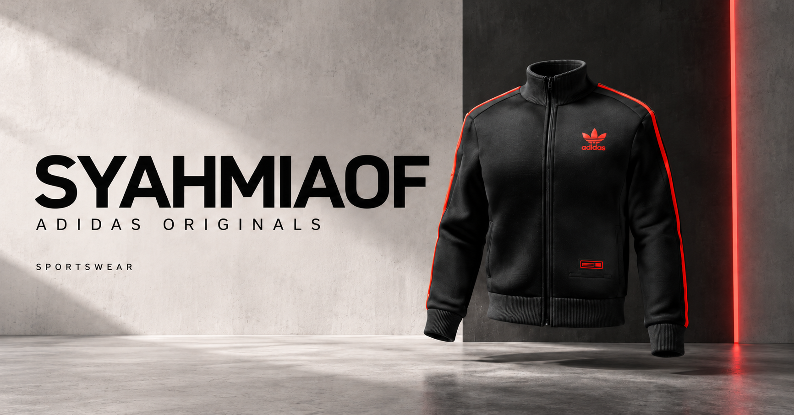

  <h1>adidas-syahmiaof</h1>
  
<strong>adidas x SYAHMIAOF — Interactive 3D WebGL Fashion Experience & Virtual Showroom</strong>

  

    
    
    
    
  

  

    
    
    
    
    
  

---

  

---

## 👟 Overview & Digital Craftsmanship

**adidas-syahmiaof** (`adidas.syahmiaof.my`) is a high-fidelity interactive 3D WebGL apparel experience and virtual showroom developed by Muhammad Syahmi. Based on deep architectural reconstruction of the iconic Foot Locker x adidas Originals CHILE20 digital showcase, this project brings complex Cinema4D geometries, 4K/8K Physically Based Rendering (PBR) fabric materials, fluid post-processing shaders, and multi-threaded WebGL pipelines into an autonomous web experience.

### Key Value Pillars:
- **Functionality**: Full 360-degree interactive camera orbit, dynamic garment customization, real-time lighting manipulation, and multi-scene cinematic transitions running on an independent static server pipeline.
- **Aesthetic Excellence**: Photorealistic PBR texture mapping (normal maps, roughness, specular reflections), custom GLUI Signed Distance Field (SDF) typography, and UnrealBloom post-processing passes.
- **Business Impact**: Demonstrates high-tier 3D eCommerce capabilities that elevate customer conversion and retail engagement for modern streetwear and luxury brands.

---

## 🔬 Engineering & Graphical Architecture

- **Hydra WebGL Engine**: Hardware-accelerated WebGL 2.0 rendering engine utilizing multi-threaded Web Workers for off-main-thread geometry parsing and matrix computation.
- **GLUI Typography**: Vector-sharp SDF font rendering enabling scale-invariant typography directly inside WebGL scene buffers.
- **Post-Processing Chain (NukePass)**: Custom GLSL fragment shader passes including UnrealBloom, procedural film grain, lens distortion, and screen-space fluid dynamics.
- **PBR Material Pipeline**: Comprehensive fabric shaders accurately rendering technical nylon windbreakers, matte cotton knits, and gloss synthetic tracksuits.

For comprehensive architectural breakdowns, shader analysis, and matrix transforms, see **[BEDAH_TEKNIKAL.md](BEDAH_TEKNIKAL.md)**.

---

## 🚀 Live Production & Infrastructure

- **Live Production URL**: [https://adidas.syahmiaof.my](https://adidas.syahmiaof.my)
- **Deployment Platform**: Vercel Cloud Platform on `main` branch
- **Continuous Validation**: Automated GitHub Actions CI workflow executing syntax verification and automated regression test suites.

---

## 📄 License & Intellectual Property

Proprietary Software. Copyright &copy; 2026 Muhammad Syahmi (`syahmiaof`). All rights reserved.  
Created solely for demonstration and portfolio showcase purposes. See [LICENSE](LICENSE) for details.
